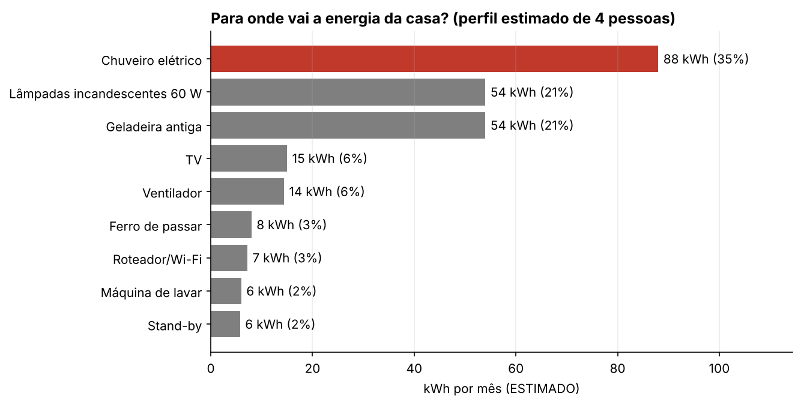
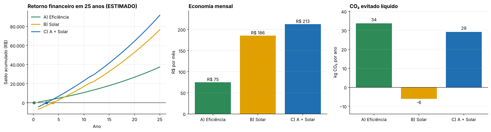
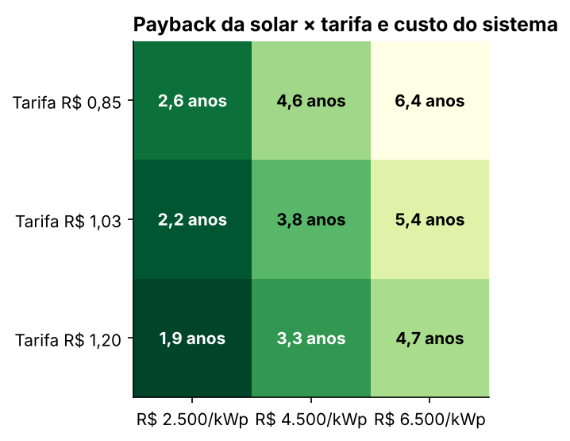

# Citizen Assist AI — Módulo de Energia e Sustentabilidade

Contribuição da disciplina **Soluções em Energias Renováveis e Sustentáveis** · Global Solution 2026 · FIAP · Ciência da Computação (1CCPJ).

## Integrantes

| Nome | RM |
|---|---|
| Conrado Gracie | 569157 |
| Renato Sandreschi | 569156 |

## Público e necessidade energética

Famílias de baixa renda em moradias urbanas da Grande São Paulo (4 pessoas, ligação monofásica) que querem **reduzir a conta de luz sem perder conforto**. O assistente explica onde a energia é gasta e compara medidas por custo, viabilidade e impacto ambiental, em linguagem simples.

## Resumo dos resultados (estimados)

- **Diagnóstico (estimado):** a casa consome cerca de **252 kWh/mês** (**R$ 260/mês**). O maior gasto é o chuveiro elétrico, com **35%** do consumo.
- **A) Eficiência:** investimento de **R$ 88**, economia de **R$ 75/mês** (73 kWh) e retorno em cerca de **1,2 meses**.
- **B) Solar:** sistema de **2,0 kWp**, investimento de **R$ 9.000**, economia de **R$ 186/mês** e retorno em cerca de **3,8 anos**.
- **C) Eficiência + solar menor:** sistema de **1,5 kWp**, investimento total de **R$ 6.838**, economia de **R$ 213/mês**, retorno em cerca de **2,6 anos** e o maior saldo em 25 anos (**R$ 91.573**).
- **Recomendação:** começar pela eficiência (A), que é barata, rápida e não depende de ninguém; depois avaliar a solar dimensionada para o consumo já reduzido (C), se houver telhado e autorização do proprietário.
- **Impacto ambiental:** o ganho climático é pequeno (A: 34 kg CO₂/ano) e, na solar, praticamente nulo (B: -6 kg CO₂/ano), porque a rede elétrica brasileira já é muito limpa. O benefício principal é financeiro.
- **Atenção:** todos os valores são **estimativas**, não garantias (ver limitações na seção 9).





### Comparação das alternativas

| Cenário        | kWp   | Consumo faturado (kWh/mês)   | Economia (kWh/mês)   | Economia (R$/mês)   | Investimento (R$)   | Payback (anos)   | Saldo acumulado em 25 anos (R$)   | CO2 evitado líquido (kg/ano)   |
|:---------------|:------|:-----------------------------|:---------------------|:--------------------|:--------------------|:-----------------|:----------------------------------|:-------------------------------|
| Situação atual | 0,00  | 252,36                       | 0,00                 | 0,00                | 0,00                | —                | 0,00                              | 0,00                           |
| A) Eficiência  | 0,00  | 179,42                       | 72,94                | 75,13               | 88,00               | 0,10             | 37.457,39                         | 33,70                          |
| B) Solar       | 2,00  | 51,12                        | 201,24               | 185,51              | 9.000,00            | 3,85             | 76.398,19                         | -6,04                          |
| C) A + Solar   | 1,50  | 30,00                        | 222,36               | 212,87              | 6.838,00            | 2,60             | 91.572,72                         | 29,22                          |



## Como a análise sustenta o assistente

Cada resposta do assistente é montada a partir das variáveis calculadas (tabela de consumo, cenários A/B/C e premissas), indica a **base** (fontes resumidas) e informa as **condições e limitações** da estimativa. A função `responder(pergunta)` identifica a intenção da pergunta e monta a resposta; `dados/base_conhecimento_energia.json` traz as mesmas respostas prontas para serem importadas pelo Citizen Assist AI.

**Exemplos de perguntas:** “Quanto eu gasto de energia?”, “O chuveiro gasta muito?”, “Vale a pena instalar painel solar?”, “Sou inquilino, posso instalar painel solar?”, “Qual o impacto ambiental?”, “Quais as referências?”

## Dados e premissas (origem, unidade, período, classificação)

| Parâmetro                              | Valor   | Unidade                  | Período/referência      | Origem / justificativa                                                                                                                                  | Classificação   |
|:---------------------------------------|:--------|:-------------------------|:------------------------|:--------------------------------------------------------------------------------------------------------------------------------------------------------|:----------------|
| Tarifa (TUSD+TE, c/ tributos) ago/2025 | 0,9317  | R$/kWh                   | ago/2025                | Fatura pública de unidade residencial monofásica da Enel SP (262 kWh) — camara.leg.br, cota parlamentar                                                 | PÚBLICO         |
| Reajuste tarifário Enel SP 2026        | 10,18   | %                        | vigência 04/07/2026     | ANEEL — efeito médio de todas as classes (10,18%). Para residenciais B1 foi divulgado ~9,02% (ver REFERENCIAS.md); a sensibilidade cobre essa diferença | PÚBLICO         |
| Tarifa adotada                         | 1,03    | R$/kWh                   | nov/2026 (sem bandeira) | (TUSD+TE ago/2025) × (1 + reajuste 2026)                                                                                                                | CALCULADO       |
| Custo de disponibilidade monofásico    | 30      | kWh/mês                  | vigente                 | REN ANEEL 1000/2021; fatura pública de 30 kWh monofásico (Enel SP, jul/2025)                                                                            | PÚBLICO         |
| Irradiação / HSP                       | 4,3     | kWh/m².dia (média anual) | média anual             | Faixa 4,1–4,6 (material USP/AMT SP; SunData/CRESESB). Valor central escolhido; confirmar no SunData                                                     | ESTIMADO        |
| Taxa de desempenho (PR)                | 0,78    | adimensional             | média anual             | Faixa típica de projeto fotovoltaico (0,75–0,85)                                                                                                        | ESTIMADO        |
| Custo do sistema FV pequeno            | 4.500   | R$/kWp                   | 2025–2026               | Solfácil (R$ 2,45/Wp, média nacional 1T/2026), Greener (4 kWp = R$ 2,84/Wp, jun/2025), Monitor do Mercado (1,5–3 kWp = R$ 10–18 mil, 2026)              | ESTIMADO        |
| Fio B sobre energia injetada           | 60      | %                        | 2026                    | Lei 14.300/2022 (escalonamento; 60% em 2026)                                                                                                            | PÚBLICO         |
| Fração injetada na rede                | 0,7     | adimensional             | média anual             | Perfil: família ausente durante o dia                                                                                                                   | HIPÓTESE        |
| Peso do Fio B na tarifa                | 0,25    | adimensional             | —                       | Ordem de grandeza; conferir na conta/ANEEL da distribuidora                                                                                             | ESTIMADO        |
| Fator de compensação                   | 0,895   | adimensional             | 2026                    | 1 − fração injetada × peso do Fio B × 60%                                                                                                               | CALCULADO       |
| Degradação dos módulos                 | 0,5     | % ao ano                 | 25 anos                 | Valor típico de garantias de fabricantes                                                                                                                | ESTIMADO        |
| Reajuste anual da tarifa               | 4       | % ao ano                 | 25 anos                 | Premissa conservadora frente aos reajustes recentes da Enel SP (13,94% em 2025; 10,18% em 2026)                                                         | ESTIMADO        |
| Fator de emissão do SIN                | 0,0385  | kgCO2/kWh                | média anual 2023        | MCTI (SIRENE) — 0,0385 tCO2/MWh                                                                                                                         | PÚBLICO         |
| Emissão de ciclo de vida da solar      | 0,041   | kgCO2e/kWh               | vida útil               | IPCC AR5 WGIII, Anexo III (mediana, solar de telhado)                                                                                                   | ESTIMADO        |
| Potências dos aparelhos                | —       | W                        | —                       | Faixas típicas Procel/INMETRO (tabela de potências); ver coluna 'origem' na tabela de consumo                                                           | ESTIMADO        |
| Tempo de uso dos aparelhos             | —       | h/dia; dias/mês          | 30 dias                 | Hipóteses de uso de família de 4 pessoas (ex.: 4 banhos × 8 min, TV 5 h/dia)                                                                            | HIPÓTESE        |

## Testes com usuários

| Participante (anônimo)   | Situação testada                                                     |   Compreensão (1-5) |   Utilidade (1-5) | Comentário recebido                                                                                                                 | Ajuste realizado                                                                                                                                        |
|:-------------------------|:---------------------------------------------------------------------|--------------------:|------------------:|:------------------------------------------------------------------------------------------------------------------------------------|:--------------------------------------------------------------------------------------------------------------------------------------------------------|
| Participante 1           | Quanto gasta o chuveiro elétrico e como economizar?                  |                   5 |                 5 | Achou excelente e direto ao ponto. Comentou que a família costuma tomar banhos longos e não sabia o impacto exato em reais.         | Nenhum ajuste necessário; entendeu o foco no chuveiro como principal gasto.                                                                             |
| Participante 2           | Vale a pena instalar painel solar sendo inquilino em casa alugada?   |                   4 |                 5 | Entendeu bem as limitações, mas sugeriu deixar mais claro, logo no início, que o proprietário precisa autorizar e arcar com a obra. | O aviso de autorização do proprietário passou a aparecer no início da resposta sobre solar e foi criada uma resposta própria para quem mora de aluguel. |
| Participante 3           | Como funcionam as lâmpadas LED comparadas às incandescentes antigas? |                   5 |                 5 | Achou a conta muito simples e rápida.                                                                                               | Nenhum ajuste.                                                                                                                                          |

Compreensão média: 4,7/5 · Utilidade média: 5,0/5.

## Estrutura do repositório

```
GS_SERS.ipynb                      notebook completo (análise, assistente e geração dos arquivos)
README.md                          este arquivo
REFERENCIAS.md                     fontes verificáveis
dados/                             consumo, premissas, comparação, sensibilidade e base do assistente
graficos/                          gráficos usados na análise
testes/                            registro dos testes com usuários
```

## Como executar

1. **Google Colab:** abrir `GS_SERS.ipynb` → *Ambiente de execução* → *Executar tudo*.
2. **Local:** `pip install pandas numpy matplotlib tabulate jupyter` e abrir o notebook no Jupyter.
3. Para conversar com o assistente, executar `conversar()` na seção 6.

## Limitações

Os valores de consumo, tarifa, custos, irradiação e emissões são **estimativas** e não representam garantia de economia, geração ou custo. Os dados de consumo são de um perfil típico e devem ser substituídos pelos dados reais da conta de luz do usuário. O resultado muda com a tarifa e a bandeira, o orçamento real, o clima, os hábitos e as regras da Lei 14.300/2022. A solar tem ganho climático líquido próximo de zero no Brasil; seu benefício principal é financeiro.
